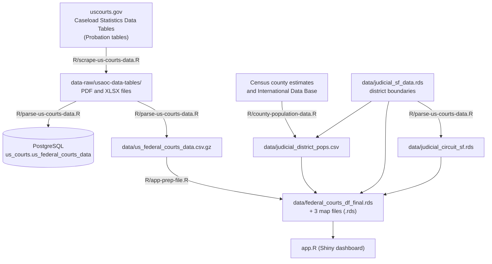

# US Federal Courts Supervision Data Dashboard

An R Shiny dashboard for exploring federal post-conviction supervision (probation, supervised release and parole) across the U.S. federal judicial districts, circuits and states, from 1997 to the present.

This README documents the whole data pipeline: how the data is **collected**, **cleaned**, **loaded into a database**, and **prepared for the app**, plus how to run and deploy the dashboard. For a plain-language guide to the *dashboard itself* (ways to use it, key terms, a column-level data dictionary, and caveats), see the **About** tab in the app.

## Contents

- [How the pieces fit together](#how-the-pieces-fit-together)
- [Repository layout](#repository-layout)
- [Run the dashboard](#run-the-dashboard)
- [Setup for the data pipeline](#setup-for-the-data-pipeline)
- [Step 1: Collect the raw files](#step-1-collect-the-raw-files)
- [Step 2: Parse, clean and upload](#step-2-parse-clean-and-upload)
- [Step 3: Build population denominators](#step-3-build-population-denominators)
- [Step 4: Prepare the app data](#step-4-prepare-the-app-data)
- [Step 5: Deploy](#step-5-deploy)
- [Refreshing the data](#refreshing-the-data)
- [Optional analysis script](#optional-analysis-script)
- [Known issues](#known-issues)

## How the pieces fit together



Everything is run from the project root (open `us-federal-court-data-dashboard.Rproj`). The scripts locate files with `here::here()` and each begins with `rm(list = ls())`.

## Repository layout

| Path | What it is |
|---|---|
| `app.R` | The Shiny app (Overview, About, Main, State and National dashboards). Reads only the prepared files in `data/`. |
| `app-old.R` | Earlier version of the app, kept for reference. |
| `R/scrape-us-courts-data.R` | Step 1. Finds and downloads the source files from uscourts.gov. |
| `R/parse-us-courts-data.R` | Step 2. Parses PDFs and XLSX files into one long table, uploads it to PostgreSQL, writes the CSV, and builds the circuit map layer. |
| `R/county-population-data.R` | Step 3. Builds yearly population for each judicial district. |
| `R/app-prep-file.R` | Step 4. Produces the four `.rds` files the app loads. |
| `R/analyze-post-conviction-supervision-by-offense.R` | Optional one-off analysis and chart (reads from the database). |
| `data-raw/usaoc-data-tables/` | Downloaded source files, named `e-<table>_<YYYY-MM-DD>.<pdf or xlsx>`. |
| `data-raw/99c8_00.txt`, `data-raw/other/e8089co.xls` | Census county population files for 1990-99 and 1980-89. |
| `data-raw/judicial_district_counties_crosswalk.csv` | County to federal judicial district crosswalk. |
| `data/` | Pipeline outputs and map inputs (see the steps below). |
| `plots/` | Output of the optional analysis script. |
| `logs/selenium.log` | Log from the Selenium server started by the scraper. |
| `renv.lock`, `renv/`, `.Rprofile` | Package versions (R 4.5.0). `.Rprofile` activates renv and sets `shiny.autoload.r = FALSE`, so files in `R/` are never auto-loaded by Shiny. |
| `manifest.json` | rsconnect deployment manifest (Shiny app, R 4.5.0). |

## Run the dashboard

You only need R 4.5.0 and the prepared files in `data/`; no database or scraping is involved.

```r
# From the project root (opening the .Rproj does this for you)
renv::restore()      # first time only: installs the locked package versions
shiny::runApp()
```

The app loads `data/federal_courts_df_final.rds`, `data/states_sf.rds`, `data/judicial_district_sf_simplified.rds` and `data/judicial_circuit_sf_simplified.rds`.

## Setup for the data pipeline

Only needed if you are refreshing the data.

| Need | Used by | Notes |
|---|---|---|
| R 4.5.0 and `renv::restore()` | all scripts | Package versions are pinned in `renv.lock`. |
| Google Chrome, Java and the Selenium standalone server (v3.141.59) | Step 1 | The script expects Chrome at `/usr/bin/google-chrome` and the jar at `/home/ubuntu/selenium-server-standalone-3.141.59.jar` (a Linux/Ubuntu server layout). Edit those two paths for your machine. |
| `SUDO_PASS` environment variable | Step 1 | Used only by `find_free_port()`, which runs `sudo lsof` to find an unused port for Selenium. |
| `CENSUS_API_KEY` environment variable | Step 3 | Free key from the Census Bureau; used by `tidycensus` and `idbr`. |
| Database credentials for the project's PostgreSQL server (Amazon RDS) | Step 2 and the optional analysis | The connection is the `dbConnect()` call at the top of each script. |
| Internet access | Steps 1, 3, 4 | Step 4 downloads state boundaries through `tigris`. |
| `CARTO_API_KEY` environment variable | the app (optional) | Basemap tiles. If unset, the app falls back to Esri tiles. |

Set keys and passwords in your user-level `~/.Renviron` or in your host's environment-variable settings. Do not commit them to the repository.

## Step 1: Collect the raw files

**Script:** `R/scrape-us-courts-data.R` &nbsp;|&nbsp; **Writes:** `data-raw/usaoc-data-tables/`

**Source:** the U.S. Courts [Caseload Statistics Data Tables](https://www.uscourts.gov/statistics-reports/caseload-statistics-data-tables), filtered to the *Probation* topic.

**What the script does**

1. Starts a Selenium server and a headless Chrome session (with a randomly chosen browser user-agent).
2. Searches the data-tables page for tables E-1, E-2, E-3, E-4, E-7, E-7A, E-8, E-8A and E-10, then pages through every results page.
3. Collects each `.xlsx` and `.pdf` link. When the site offers both formats for the same table and period, the XLSX is kept.
4. Names each file `e-<table>_<reporting period date>.<pdf|xlsx>` (for example `e-1_2025-09-30.xlsx`). The date is the site's "Reporting Period", which is not always the date a column inside the file reports.
5. Stops the Selenium server and downloads the files with `curl`.

**What is in `data-raw/usaoc-data-tables/`**

| Table | Contents | Formats and range in the repo |
|---|---|---|
| E-1 | Persons received for and removed from supervision, 12-month period ending on the date | PDF 1997-09-30 to 2017-06-30; XLSX 2017-09-30 onward |
| E-2 | Persons under supervision, as of the date | PDF 1997-09-30 to 2017-06-30; XLSX 2017-09-30 onward |
| E-3 | Persons under supervision by offense, as of the date | PDF 1997 to 2016; XLSX 2017 onward (annual, Sept. 30) |
| E-8 | Post-conviction supervision cases revoked and closed, 12-month period | XLSX, annual, from 2022 |
| E-8A | Post-conviction supervision cases closed, 12-month period | XLSX, annual, from 2022 |
| E-10 | Presentence investigations, 12-month period | XLSX, annual, from 2022 |
| E-4, E-7, E-7A | Downloaded but **not used** | Not parsed in Step 2 |

E-1 and E-2 are reported once a year (Sept. 30) from 1997 to 2000 and quarterly from 2001.

## Step 2: Parse, clean and upload

**Script:** `R/parse-us-courts-data.R` &nbsp;|&nbsp; **Reads:** `data-raw/usaoc-data-tables/`, `data/judicial_sf_data.rds` &nbsp;|&nbsp; **Writes:** the database table `us_courts.us_federal_courts_data`, `data/us_federal_courts_data.csv.gz`, `data/judicial_circuit_sf.rds`

### What gets parsed

- **XLSX:** every XLSX except E-7 and E-7A, which means E-1, E-2, E-3, E-8, E-8A and E-10.
- **PDF:** E-1, E-2 and E-3 only. (E-4 and E-7 PDFs are ignored.)

### XLSX parsing

The spreadsheets have multi-row headers, stacked blocks, footnotes and circuit sub-headings. The script merges the header rows into single column names, carries the table title down, separates circuit rows from district rows, moves footnote text into a `notes` column, and pivots everything to long format (one row per place, table line and date).

### PDF parsing

The older PDFs are read with `pdftools::pdf_data(font_info = TRUE)`, which returns every word with its position and font size. The script rebuilds each table from that layout:

- the largest font on a page marks the table title and very small fonts (about 3 to 6.5 pt) mark footnotes;
- rows are recovered by clustering the words' vertical positions (`hclust`, with a tolerance of 7 points on a 792 x 612 pt page), and columns by clustering their horizontal positions into the number of columns the table is expected to have (estimated from the most common number of cells per row);
- multi-line column headings are stitched together, page headers and "Page x of y" lines are removed, and the table is pivoted to the same long format as the XLSX output.

One known misaligned block (Utah in the Dec. 31, 2009 E-1 PDF) is corrected by hard-coded values in the script.

### Standardizing and cleaning

After the two sources are stacked (`file_type` records `PDF` or `XLSX`), the script:

- **harmonizes measure names across eras.** For example, "judge" and "magistrate judge" probation both become `probation`; mandatory release and prisons custody become `bop_custody`; military, special and term-of parole become `parole`. This produces `variables` (the full measure name), `categories` (the display group, such as *Received For Post-Conviction Supervision* or *Persons Under Supervision*) and `variables_simple` (the measure without its group prefix);
- **repairs place codes** such as `A,N` to `IA,N`, `Y,W` to `NY,W`, `GUAM` to `GU` and `NMI` to `MP`, and normalizes capitalization;
- **drops** rows with no value and the E-3 presentence-investigation totals;
- **sums rows that are identical in every column except `values`**, so each place, table line and date appears once.

### Outputs and upload

1. **Database upload.** The script connects to the project's PostgreSQL server, runs `CREATE SCHEMA IF NOT EXISTS us_courts`, and writes the cleaned table to `us_courts.us_federal_courts_data` with `overwrite = TRUE`. Each run therefore **replaces** the table with a fresh snapshot rather than appending to it.
2. **CSV.** The same table is written to `data/us_federal_courts_data.csv.gz` (any existing copy is deleted first). This is the file Step 4 reads, so the app never needs database access.
3. **Circuit map layer.** `data/judicial_sf_data.rds` (one polygon per judicial district) is dissolved by `circuit`, summing the `population` column, and saved as `data/judicial_circuit_sf.rds`.

The uploaded table has 15 columns:

| Column | Meaning |
|---|---|
| `circuit_and_district` | Circuit label as printed in the source (for example `1st`, `DC`). |
| `state_or_district` | Place code as printed in the source (for example `TX,N`), including `TOTAL` and circuit-total rows. |
| `table_name_date`, `file_name` | Date and name of the source file. |
| `table_num`, `table_desc`, `table_name_full` | Table number (E-1, E-2, ...) and title parsed from the file. |
| `variables`, `categories`, `variables_simple` | Standardized measure name, its group, and the measure without the group prefix. |
| `original_categories` | The column name as parsed, before harmonizing. |
| `date` | The date embedded in the column heading, when the source gives one. |
| `file_type` | `PDF` or `XLSX`. |
| `values` | The reported number. |
| `notes` | Footnote text from the source table. |

The dashboard's own data dictionary (in the **About** tab) describes the final app file, which adds the derived columns listed in Step 4.

### Map boundaries

`data/judicial_sf_data.rds` is an **input** to this project: no script in `R/` creates it. It holds 95 judicial-district polygons (EPSG:4326) with `objectid`, `state_district`, `state_abbr`, `state_fips`, `state_name`, `website`, `circuit`, `court_webs` and `population` columns. The repository does not record where it came from, so add the source and download date here when you have them.

## Step 3: Build population denominators

**Script:** `R/county-population-data.R` &nbsp;|&nbsp; **Writes:** `data/judicial_district_pops.csv`

The dashboard's per-capita rates (cases per 10,000 residents) need a population for each federal judicial district and year. The script builds it from county estimates:

| Years | Source |
|---|---|
| 1980-1989 | `data-raw/other/e8089co.xls` (Census county estimates) |
| 1990-1999 | `data-raw/99c8_00.txt` (Census 1990-2000 county totals) |
| 2000-2009 | Census `cc-est2009-alldata-<state FIPS>.csv` files, downloaded state by state (total population, all ages) |
| 2010-2019 | `tidycensus::get_estimates()`, vintage 2019 |
| 2020 onward | `tidycensus::get_estimates()`, latest vintage |
| American Samoa, Guam, Northern Mariana Islands, Puerto Rico, U.S. Virgin Islands | Census International Data Base through `idbr::get_idb()`, used where county data is not available |

From 2000 onward the script keeps the July 1 estimate for each year. County names and FIPS codes are reconciled across eras (for example, Shannon County, SD became Oglala Lakota County; Dade County, FL became Miami-Dade; some Virginia independent cities are merged into their counties).

**County to district.** `data-raw/judicial_district_counties_crosswalk.csv` maps each county FIPS code to a judicial district. Where a county changed districts, the latest assignment is used. South Carolina is treated as one statewide district, and Alaska, Connecticut and South Dakota fall back to statewide when a county has no match. County estimates are summed by district and year.

**Output.** `judicial_district_pops.csv` has four columns (`state_district`, `year`, `district_id`, `estimate`) and covers 95 districts for 1980-2024 (the last year available when it was built). The newest year is set from the system date (`latest_year` is last calendar year), so re-running in a new year picks up the next Census vintage.

`data-raw/IDB_11-20-2025.csv` and `data-raw/other/districts_with_states.csv` are in the repository but are not read by any script in `R/`.

## Step 4: Prepare the app data

**Script:** `R/app-prep-file.R` &nbsp;|&nbsp; **Reads:** `data/us_federal_courts_data.csv.gz`, `data/judicial_district_pops.csv`, `data/judicial_sf_data.rds`, `data/judicial_circuit_sf.rds` &nbsp;|&nbsp; **Writes:** four `.rds` files in `data/`

This step does the heavy lifting once, so the app starts quickly.

1. **Drop E-1 population rows.** E-1 `persons_under_supervision` rows are removed; the app takes the supervised population from E-2 instead.
2. **Build dates.** `date_full` is the date from the column heading, or the file date when the heading has none. From it come `year`, `date_month`, `date_quarter` (months 3, 6, 9 and 12 become Q1 to Q4) and `quarter_name_full` (for example `2025, Q3`).
3. **Name places.** The code in `state_or_district` (for example `TX,N`) is split and expanded into `state_name` and `state_district` (for example `Texas Northern`), including the territories and D.C. `circuit_and_district` is renamed `circuit`.
4. **Add population and rates.** District populations are joined by year and place. Circuit and national (`Total`) populations are the sums of their districts. If a quarter falls after the latest population year, the most recent estimate is carried forward. Then `values_per_capita = 10000 * values / population`.
5. **Reconcile with reported totals.** For every quarter, `categories` and `variables_simple` combination, the sum of the district rows is compared with the table's own `TOTAL` row. Combinations that differ by more than 5% are removed entirely, because a mismatch usually means a parsing or reporting problem. In the data committed with this repository, 36 combinations are removed this way, all between 2011 Q4 and 2012 Q2.
6. **Prepare map layers.** State boundaries come from `tigris::states(cb = TRUE)` (American Samoa removed; U.S. Virgin Islands and Northern Mariana Islands renamed to match the data). District and circuit polygons are simplified with `rmapshaper::ms_simplify(keep = 0.05, keep_shapes = TRUE)`.

**Outputs**

| File | Contents |
|---|---|
| `data/federal_courts_df_final.rds` | The long data table the app uses: the 15 columns from Step 2 (with `circuit_and_district` renamed `circuit`) plus `date_full`, `date_month`, `year`, `date_quarter`, `state_name`, `state_district`, `quarter_name_full`, `population` and `values_per_capita`. |
| `data/states_sf.rds` | State polygons for the maps. |
| `data/judicial_district_sf_simplified.rds` | Simplified district polygons. |
| `data/judicial_circuit_sf_simplified.rds` | Simplified circuit polygons. |

`data/judicial_sf_data.rds` and `data/judicial_circuit_sf.rds` are large unsimplified inputs; the app does not load them.

## Step 5: Deploy

The app needs only `app.R` and the four prepared `.rds` files. The repository includes an rsconnect `manifest.json` (Shiny app, R 4.5.0), so it can be deployed from Git to a Posit Connect style host. Set `CARTO_API_KEY` in the host's environment settings if you want CARTO basemap tiles. After changing packages, update `renv.lock` (`renv::snapshot()`) and regenerate the manifest (`rsconnect::writeManifest()`).

## Refreshing the data

When the U.S. Courts publish a new quarter or year:

1. **Collect.** Run `R/scrape-us-courts-data.R` (or download the new files by hand into `data-raw/usaoc-data-tables/` using the naming pattern above).
2. **Parse and upload.** Run `R/parse-us-courts-data.R`. This replaces the database table and rewrites `data/us_federal_courts_data.csv.gz` and `data/judicial_circuit_sf.rds`.
3. **Population (usually yearly).** Re-run `R/county-population-data.R` when the Census releases a new county estimate vintage.
4. **Prepare.** Run `R/app-prep-file.R`.
5. **Check.** Run the app and confirm the "as of" date on the Overview tab and that the latest quarter appears in the dashboards.
6. **Publish.** Commit the updated files in `data/` (and the new files in `data-raw/`), then redeploy.

## Optional analysis script

`R/analyze-post-conviction-supervision-by-offense.R` reads table E-3 (latest total) from `us_courts.us_federal_courts_data` in the database and saves a chart of the supervised population by offense type to `plots/sup_pop_by_crime_type.pdf`. It is not part of the app pipeline.

## Known issues

These are documented here so nobody is surprised by them. Delete an item once it is fixed.

- **Three PDF tables have no table number.** E-1 for 2012-12-31 and E-3 for 2009-09-30 and 2012-09-30 parse without a table title, so their `table_num` is blank. The app filters on `table_num`, so Q4 2012 admissions and exits and the 2009 and 2012 E-3 offense snapshots are missing from the dashboards. The fallback in `R/parse-us-courts-data.R` (`ifelse(table_num == "", ...)`) handles empty strings but not `NA`, which is what these files produce.
- **The scraper's download loop does not fetch new files.** The final `while` loop in `R/scrape-us-courts-data.R` tests `setdiff(files_read, full_df$file_name_full)`, which lists files that are on disk but not on the website. It is empty when you are only missing files, so nothing downloads, and it would never end if a stray local file existed. Swapping the arguments (`setdiff(full_df$file_name_full, files_read)`) makes it download what is missing. Until then, download new files by hand.
- **Machine-specific paths.** The Selenium jar and Chrome paths in the scraper are hard-coded for an Ubuntu server (see [Setup](#setup-for-the-data-pipeline)).
- **Source of `judicial_sf_data.rds` is not recorded** (see Step 2).
